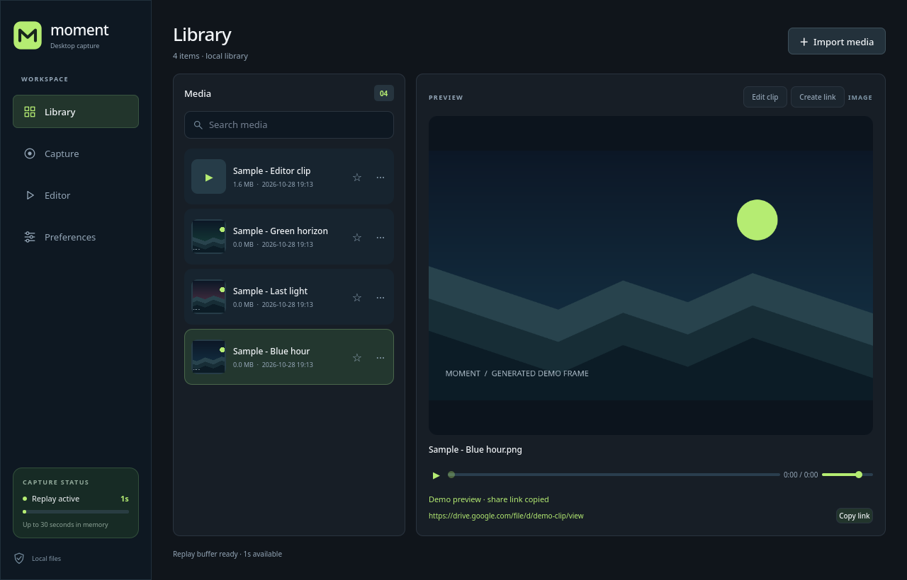

# Moment

Replay e captura de gameplay para Linux. Deixe o Moment rodando em segundo plano e aperte **F8** para salvar os últimos segundos da tela ou **F9** para tirar um print.

O app é feito em C++ e Qt Quick, com captura pelo PipeWire e pelos portais do desktop. O foco atual é Wayland, principalmente KDE Plasma.



Biblioteca do Moment com mídia de exemplo.

## O que já funciona

- Replay com duração configurável e gravação de sessões.
- Capturas de tela em PNG e clipes em MP4.
- Seleção do dispositivo de áudio.
- Biblioteca local com reprodução, busca e favoritos.
- Editor para cortar o início e o fim do vídeo, com quatro opções de qualidade na exportação.
- Perfis de captura por jogo e detecção de jogos e launchers.
- Atalhos globais, confirmação de captura na tela e execução na bandeja do sistema.
- Atividade no Discord com o jogo ou launcher detectado.

O editor ainda é simples: não tem timeline de várias faixas, transições ou efeitos. A detecção de jogos também não identifica kills, vitórias ou outros eventos da partida.

## Instalação no Arch Linux

O repositório inclui um `PKGBUILD`. No Arch, CachyOS e derivados:

```sh
git clone https://github.com/rancidavi-dotcom/MomentReplay.git
cd MomentReplay
makepkg -si
```

Depois, abra **Moment** pelo menu de aplicativos ou execute `medal-linux` no terminal. O `makepkg` precisa dos pacotes `base-devel` e `git` instalados.

## Compilar manualmente

Requer Qt 6.8 ou mais recente, CMake 3.21+, um compilador C++20, QtKeychain, SQLite, GStreamer, PipeWire e FFmpeg.

No Arch, instale as dependências:

```sh
sudo pacman -S --needed base-devel git cmake qt6-base qt6-declarative \
  qt6-multimedia qtkeychain-qt6 sqlite gstreamer gst-plugins-base \
  gst-plugin-pipewire ffmpeg
```

`layer-shell-qt` é opcional e melhora a integração dos popups com desktops compatíveis.

```sh
cmake -S . -B build -DCMAKE_BUILD_TYPE=Release
cmake --build build --parallel
./build/medal-linux
```

Para instalar somente na sua conta:

```sh
cmake --install build --prefix "$HOME/.local"
```

Nesse caso, `~/.local/bin` precisa estar no `PATH` da sessão para o lançador encontrar o executável.

## Primeiro uso

1. Abra o Moment e selecione a tela no diálogo de compartilhamento do desktop.
2. Aguarde o indicador **Replay active** e alguns segundos de captura.
3. Use **F8** para salvar um replay. O clipe aparece na **Library**.
4. Para cortar um vídeo, selecione o clipe, abra **Edit clip**, ajuste as alças e salve.

As preferências permitem mudar a duração do replay e do clipe, FPS, qualidade, áudio e atalhos. O desktop pode pedir a confirmação dos atalhos globais; a disponibilidade depende do portal instalado.

Fechar a janela mantém o Moment na bandeja. Para encerrar a captura e o aplicativo, escolha **Quit Moment** no ícone da bandeja.

Vídeos e prints ficam nas pastas de vídeos e imagens da sua conta, dentro de `Moment`. Remover um item da biblioteca não apaga o arquivo original.

## Compartilhamento pelo Google Drive

A integração com o Drive ainda está em desenvolvimento e precisa de uma build com OAuth configurado. Ela envia uma cópia do clipe para o Drive da conta conectada e gera um link público para quem o receber.

Antes do envio, o Moment prepara um MP4 com H.264 e AAC para reprodução no navegador. O Google pode levar algum tempo para processar o vídeo depois do upload.

Quem prepara uma build com essa integração deve configurar `MOMENT_GOOGLE_OAUTH_CLIENT_ID` e `MOMENT_GOOGLE_OAUTH_CLIENT_SECRET` no cache local do CMake. Credenciais não acompanham o repositório. O consentimento usa o escopo `drive.file`, e o token de renovação fica no chaveiro do sistema.

## Compatibilidade

O desktop precisa oferecer os portais **ScreenCast** e **GlobalShortcuts**. O backend do portal deve corresponder ao ambiente gráfico em uso, por exemplo `xdg-desktop-portal-kde` no Plasma. A escolha da tela pode ser reaproveitada nos desktops que oferecem esse recurso.

O suporte foi desenvolvido principalmente no KDE Plasma com Wayland. Outros desktops podem ter diferenças nos atalhos e nas permissões de captura. X11 ainda não tem um backend próprio.

## Desenvolvimento

```sh
ctest --test-dir build --output-on-failure
```

Para usar um perfil separado durante o desenvolvimento:

```sh
./build/medal-linux --data-dir /tmp/moment-dev
```

Ao relatar um problema, inclua a distribuição, o desktop, a versão do Qt e os passos para reproduzir. Confira o log antes de publicar: ele pode conter caminhos de arquivos da sua conta.

## Licença

O código do Moment está sob a [licença MIT](LICENSE). Qt, FFmpeg e as demais dependências têm suas próprias licenças.
