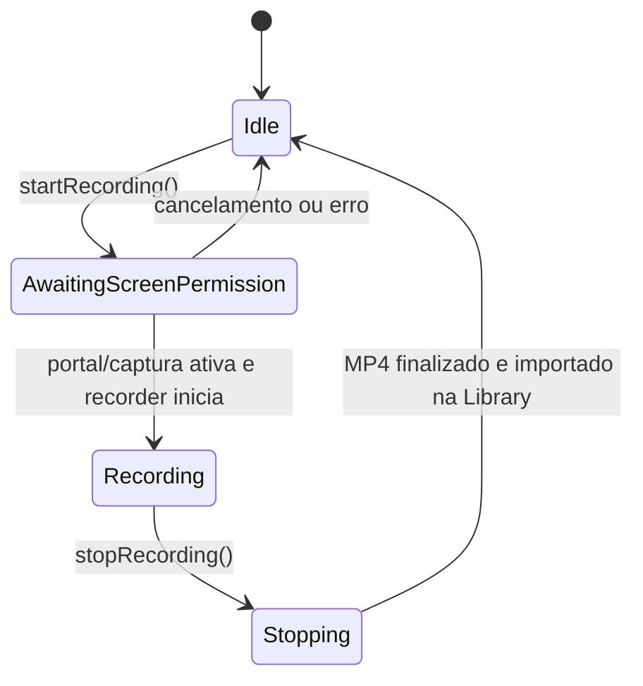
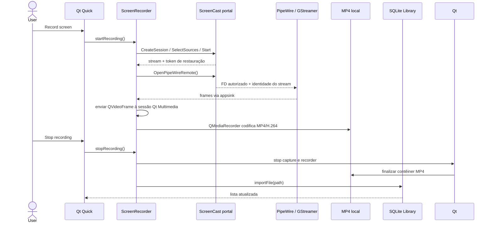

# Gravação contínua de tela — primeira vertical

## Escopo e status

Esta é a primeira etapa executável do motor Linux. Inicia uma captura de tela explicitamente solicitada pelo usuário, codifica um MP4/H.264, finaliza o arquivo ao parar e adiciona o arquivo à Library local. Estado: **implementação inicial; fluxo do encoder e catálogo testado com frames sintéticos; captura de tela/portal ainda não validada no compositor atual**.

Não implementa captura de janela/jogo, pause/resume, detecção automática de jogo, editor ou compartilhamento. Áudio agora é uma única entrada PCM opcional, mas ainda não foi validado ao vivo junto da gravação contínua. Portanto não equivale ao sistema de gravação do Medal.

## Evidência Medal usada como requisito

- A análise REA managed registrou `WSHandlers.ToggleSessionRecording` disparando um evento para `EncoderMachine`; `RecordingSession` constrói a pipeline. São relações estáticas da build analisada, não observações dinâmicas. Referências completas estão em `../medal_reverse_engineering/04_RECORDING_ENGINE.md`, `05_CLIP_SAVE_TRACE.md` e `EVIDENCE_INDEX.md`.
- A existência do chunk `renderer-ScreenRecording.js` está demonstrada pelo inventário do ASAR, mas o fluxo visual e sua relação runtime com a sessão continuam desconhecidos.
- O projeto Linux implementa um requisito próprio de desktop: iniciar/parar, preservar o arquivo localmente e mostrar a gravação na biblioteca. A semântica/UX detalhada do Medal não foi copiada nem considerada equivalente.

## Implementação nova

`ScreenRecorder` controla `QMediaCaptureSession` e `QMediaRecorder`. A fonte Wayland usa o portal ScreenCast diretamente e recebe vídeo via `pipewiresrc`/GStreamer; isso permite pedir ao portal que persista a seleção com um restore token. O replay inicia ao abrir o Moment; a gravação contínua inicia quando a pessoa aciona **Start session recording**. Em ambos os casos o portal mantém a decisão de consentimento. A saída é criada em `Movies/Moment/` (com fallback em dados locais se o diretório XDG Movies não existir), com nome timestamp + sufixo aleatório. Depois que o recorder para e o arquivo não está vazio, o modelo da Library importa o caminho no SQLite.

O encoding solicita MP4/H.264 e o perfil configurado via Qt Multimedia. Com a opção Audio Input desligada (default), o arquivo é somente vídeo; quando ativada, o aplicativo solicita AAC e conecta uma entrada PCM ao mesmo capture session. A disponibilidade de codecs depende do backend/host, e a implementação mostra erro se Qt não declarar o formato combinado como suportado.

O código implementa a sequência D-Bus e leitura do stream PipeWire. O usuário confirmou que o seletor de tela funciona e que o token evita pedir permissão novamente após fechar e reabrir o app. Isso é validação manual reportada; a gravação contínua e o áudio continuam cobertos somente por testes sintéticos/parciais.

## Verificação realizada

- `cmake -S . -B build -DCMAKE_BUILD_TYPE=Debug` e `cmake --build build -j2`: concluídos sem erro.
- `ctest --test-dir build --output-on-failure`: 5/5 testes passaram na revisão de 27/10/2026.
- `screen-recorder-test` injeta frames com `QVideoFrameInput`, espera o arquivo MP4 ser finalizado e confirma a inclusão no SQLite.
- Esse teste valida encoding/fechamento/indexação de vídeo neste host. O mux/decode de áudio sintético é coberto pelo `instant-replay-test`, mas não existe ainda teste integrado de áudio sintético na sessão contínua. Não são gravados microfone/áudio real pelos testes.
- Não foi medido desempenho, uso de CPU/GPU ou diferença contra o Medal.

## Limitações e próximos experimentos

1. No desktop Wayland, testar uma gravação curta com uma fonte de áudio escolhida e comparar sincronização com vídeo e playback.
2. Reabrir o arquivo da Library e confirmar duração/seek/playback do MP4 real de captura.
3. Tratar revogação/perda da sessão, falta de espaço, crash durante mux, áudio de sistema/microfone e desconexão da entrada.
4. Investigar com REA/Ghidra os caminhos `scope_io_buffer_export_from_timestamp`, `scope_io_buffer_exportable_duration` e callbacks da pipeline antes de desenhar o replay Linux.

## Requisitos de plataforma e fontes

O portal ScreenCast define `persist_mode` e `restore_token`, para restaurar a fonte após novas sessões, com token de uso único renovado a cada início. PipeWire é aberto pelo FD autorizado do portal. Ver [XDG ScreenCast](https://flatpak.github.io/xdg-desktop-portal/docs/doc-org.freedesktop.portal.ScreenCast.html) e [Qt Multimedia Linux](https://doc.qt.io/qt-6/qtmultimedia-linux.html); essas referências documentam a plataforma Linux, não o Medal.
