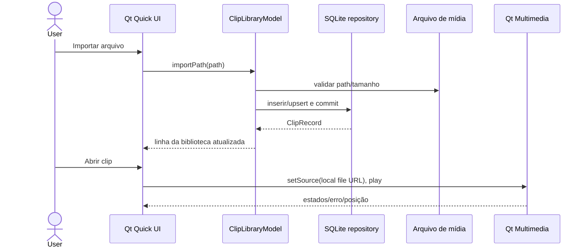

# Especificação vertical 1 — catálogo local e reprodução

## Proveniência e escopo

Esta é uma especificação independente para uma primeira fatia útil: importar um vídeo local para um catálogo, persistir seus metadados, encontrá-lo, removê-lo do catálogo sem apagar mídia e reproduzi-lo. Não pretende cobrir toda a Library do Medal nem copiar seus serviços/código.

### O que o snapshot Medal demonstra

- Inventário REA completo do ASAR encontrou os módulos `renderer-LibraryLayout.js`, `renderer-LibraryClips.js`, `renderer-LibraryClips2.js`, `renderer-LibraryGameClips.js`, `renderer-LibrarySessions.js`, `renderer-LibraryProjects.js`, `renderer-LibraryDateScrollbar.js`, `renderer-ClipContextMenu.js`, `renderer-DeleteClipConfirmationModal2.js`, `renderer-useLibraryClipCounts.js`, `renderer-library-category-util.js`, `renderer-library-cache.js`, `renderer-useClipFavorite.js` e `renderer-useRestoreDeletedClip.js`. O inventário confirma os arquivos, não a execução.
- Análise estática focada de 15 módulos (30.259 nós AST, 659 findings e zero falhas de parse; cobertura sintática completa dentro dos 15 selecionados) extraiu de `renderer-LibraryLayout.js` candidatos a rotas `/library`, `/library/sessions`, `/library/screenshots`, `/library/drafts`, `/library/favorites`, `/library/liked`, `/library/posts`, `/library/games`, `/library/people`, `/library/saved`, `/library/clips-you-are-in`, `/library/sent-by-friends`, `/library/recently-deleted` e `/library/watch-history`.
- O extrator classifica essas strings como `endpoint_kind=route`, `interpretation=candidate`, inferidas de uma propriedade `path`; não prova que cada rota esteja registrada, alcançável ou apareça ao usuário.
- Facts estáticos encontraram `localStorage.getItem`, `setItem` em `renderer-LibraryLayout.js` e `getItem`, `setItem`, `removeItem` em `renderer-library-cache.js`. O nome/chave dinâmica e os valores não foram resolvidos. Isso prova calls presentes nos módulos analisados, não que o banco de clipes seja localStorage.
- O encoder managed envia `ClipSavedData` via `IRequests.ClipSaved` e obtém `ContentId`; o destino do request e a atualização final do renderer permanecem desconhecidos (`ev_608a…`).

## Requisitos independentes do slice

1. Importar um ou mais arquivos escolhidos pelo usuário usando seletor nativo; validar extensão/path sem carregar bytes completos na memória.
2. Persistir no banco local um registro estável contendo ID interno, caminho absoluto, nome legível, data de importação, tamanho, status de acessibilidade e favoritos locais.
3. Impedir duplicação pelo caminho canônico; reportar arquivo ausente/indisponível sem travar a lista.
4. Apresentar lista pesquisável e ordenável por data/nome; vazio, loading e erro precisam ter estados visíveis.
5. Remover um registro do catálogo mediante confirmação. Essa ação **não** apaga nem move o arquivo original.
6. Abrir e reproduzir arquivo suportado, com pausa, seek e volume básicos. Codec não instalado deve produzir erro útil e manter o registro.
7. Guardar o mínimo de dados pessoais; não ler metadados de conta nem conectar à nuvem.
8. Manter banco, thumbnails/cache e logs sob `QStandardPaths` XDG; fixture e DB de testes ficam em temporário e são apagados pelo runner.

## Fluxo local a testar

Esse é o fluxo da aplicação nova, não um fluxo interno do Medal. O evento `ClipSaved` será ligado à mesma API de catálogo num incremento futuro, quando recorder Linux existir.

## Implementação e verificação

Implementação inicial criada em `src/library/` e `qml/Main.qml`: seletor de arquivo, catálogo SQLite, pesquisa, favoritos locais, confirmação de remoção do registro e player Qt Multimedia. Stack de ambiente observada sem alterações: Qt 6.12 (Core/Quick/QML/Multimedia/Test/SQL), SQLite 3.54, GStreamer 1.28.8 e PipeWire 1.6.10; compilador C++ e CMake presentes; Rust/cargo não encontrados. Não foram instalados pacotes.

Seis testes funcionais QtTest passaram: persistência/reopen/pesquisa/favorito, importação duplicada, remoção sem apagar mídia, rejeição de caminho/formato inválido, schema SQLite mais novo e fluxo do `ClipLibraryModel` (import → query → favorite → remove). Um teste de integração de mídia gerou um vídeo sintético via FFmpeg e observou frames válidos e duração via Qt Multimedia. Build passou; smoke QML offscreen permaneceu ativo até o timeout controlado de 2 s. O host imprimiu um warning `pa_write()` ao encerrar o smoke sob sandbox. Nenhum arquivo real ou mídia privada foi importado.

## Limite da primeira fatia

Esta não implementa as rotas de feed candidatos, perfil, share, posts, sessões, projetos, restore/recently deleted ou integração Medal. Também não indexa recursivamente pastas, não cria thumbnails ainda. Teste de codec verifica decode de fixture local, não comparação com o player Medal. A fatia não afirma paridade validada. Essas funções exigem investigação e requisitos separados na matriz.
