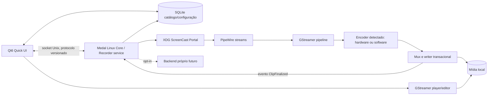

# Arquitetura e sequência de desenvolvimento para Linux

## Escopo e origem

Proposta inicial para reimplementar a experiência desktop com código original. Os achados do Medal são os listados na matriz e nos Evidence IDs de REA; escolhas abaixo são **propostas independentes**, não afirmações sobre como o Medal funciona. A primeira fatia local foi implementada depois deste plano; ela ainda não constitui equivalência com as telas/rotas do Medal.

## Decisões de arquitetura

### Tecnologias avaliadas

| Área | Opção | Avaliação para este projeto |
|---|---|---|
| Linguagem de desktop | C++ moderno / Rust | C++ é a escolha inicial para combinar Qt6 e APIs C/C++ de GStreamer com poucas pontes ABI. RAII, tipos de propriedade, sanitizers e testes mitigam riscos. Rust é forte para um serviço de captura concorrente, mas misturá-lo já com Qt e GStreamer adicionaria FFI e build complexity antes de haver um contrato estável. Reavaliar Rust para serviço separado se os limites de concorrência/segurança justificarem. |
| GUI | Qt6 Quick/QML | Escolha inicial para navegação, cards, player e timeline customizados, com lógica/modelos em C++. Qt suporta execução como cliente Wayland via QPA e pode oferecer backend X11 conforme build. Revisar licença de cada módulo Qt escolhido antes da distribuição; Qt open source não significa que todo módulo seja LGPL. |
| GUI alternativa | GTK4 | Opção sólida e nativa para Wayland/X11, potencialmente mais integrada ao desktop GNOME. Não selecionada inicialmente porque a interface rica, editor visual e timeline demandam muitos componentes customizados e o time precisaria escolher entre C/Rust bindings. Reavaliar após protótipo de acessibilidade/ergonomia, sem adotar por padrão. |
| Captura Wayland | XDG Desktop Portal ScreenCast + PipeWire | Base para captura com consentimento: criar sessão, selecionar fontes, iniciar, receber PipeWire streams e conectar consumidor. Stream/node identifiers são válidos por sessão; gerir encerramento, perda de sessão e renegociação. Captura de jogo específica pode variar entre compositores e precisa ser testada. |
| Captura X11 | Adapter separado | Adicionar depois do caminho Wayland; não misturar permissões/protocolo com compositor Wayland. Seleção de janela/monitor e captura serão comparadas em ambiente X11 isolado. |
| Grafo multimídia | XDG ScreenCast + GStreamer appsink + Qt Multimedia writer | A captura Wayland usa diretamente o portal e `pipewiresrc`, com `persist_mode=2`/restore token para reduzir seletores repetidos; GStreamer entrega frames ao Qt Multimedia para reaproveitar buffer/export e MP4/H.264. O fluxo de sessão/token ainda aguarda validação no compositor; X11 é adapter separado. Segmentação/encoder ainda poderão migrar para GStreamer após comparação de robustez e codecs. |
| Alternativa multimídia | FFmpeg libraries | Bom para controle de codec/demux/mux, análise e conversão; licenças variam com configuração e codecs ativados. Pode entrar como ferramenta de compatibilidade/export somente após uma necessidade concreta e SBOM/licença conferidos. Não usar CLI como daemon por padrão. |
| Alternativa multimídia | libobs | Avaliar como backend/protótipo se economia de tempo e recursos de captura/encode forem significativos. API de alto nível, módulos e perfil de compositor devem ser testados. OBS/libobs é GPL-2.0-or-later: verificar o efeito sobre a licença/distribuição do projeto antes de linking ou bundling. Não é dependência escolhida agora. |
| IPC | Socket Unix local com protocolo versionado | UI envia comandos e recebe eventos; mensagens length-prefixed, versionadas, idempotency IDs, validação e ACL de socket. Iniciar recorder separado para isolar crash/backpressure; sem rede local aberta. D-Bus pode ser usado para integração de desktop, não como protocolo de mídia pesado. |
| Persistência | SQLite + arquivos em diretórios XDG | SQLite guarda índice/configuração/metadata e migrações; arquivo de mídia permanece em filesystem. Usar transações, import/rename atômico, checksums opcionais, thumbnails regeneráveis. Não guardar tokens em SQLite. |
| Backend | API própria opcional | Compartilhamento, sync, autenticação e perfil não serão conectados ao serviço Medal. Definir serviço próprio com auth, upload resumível, políticas de retenção/remoção, rate limiting e endpoints versionados. O desktop local permanece útil sem conta/rede. |

### Grafo proposto

Portal e PipeWire têm um contrato documentado para sessão e streams; os outros elementos do desenho são decisões da implementação. O primeiro protótipo deve aferir se recorder e UI podem compartilhar processo sem prejudicar recuperação; desenho alvo separa recorder para manter a interface responsiva quando um pipeline falha.

## Fluxos e responsabilidades

- **UI:** navegação, modelos de tela, playback, edição não destrutiva, configurações e consent prompts; não acessa buffers do recorder diretamente.
- **Core:** lifecycle de captura/sessão, capacidades disponíveis, hotkeys, eventos e validação de perfil; máquina de estados observável e testável.
- **Media engine:** adapters portal/PipeWire e GStreamer; timestamps monotônicos, clocks A/V, backpressure explícita e encoder capability probing.
- **Writer:** arquivos temporários, fechamento/container final, fsync opcional, rename atômico, erro recuperável; notifica apenas após clip legível.
- **Catalog:** evento local finalizado gera linha/thumbnail; reconcilia órfãos após crash; nenhuma informação de cloud obrigatória.
- **Cloud adapter:** pacote separado e opt-in; interface de domínio não depende de serviços privados do Medal.

## Estratégia para replay buffer independente

Ainda não se conhece o algoritmo nativo do Medal. Projeto Linux precisa especificar e testar um método próprio. Candidato a estudo: manter segmentos curtos já codificados, indexados por PTS, com duração/bytes máximos; fixar os segmentos necessários durante export, escrever clipe novo sem parar ingestão, alinhar áudio pelo clock da pipeline e limpar segmentos antigos após liberar referências. Essa hipótese só deve virar design depois de um spike GStreamer que prove limites, keyframe boundaries, A/V drift, backpressure e recuperação. Não declarar paridade de algoritmo com o Medal.

## Sequência de desenvolvimento

| Marco | Pesquisa REA e especificação | Implementação vertical | Teste/aceite |
|---|---|---|---|
| 0. Aprofundar mapa do produto | Selecionar renderer chunks por rota/família; mapear IPC main; analisar biblioteca, player/editor, settings, hotkeys, sharing e updater; atualizar Evidence e matriz. Abrir `scope.dll` no Ghidra se ferramenta já existir e usuário aprovar configuração/uso. | **Concluído nesta etapa:** matriz, planos REA/Ghidra e proposta Linux escritos. A primeira análise Library parseou 15 módulos, ainda sem comparar visualmente. | Documentação em `MEDAL_FEATURE_PARITY.md`, `REA_INVESTIGATION_BACKLOG.md` e esta proposta; investigação de produto continua parcial. |
| 1. Biblioteca local vertical (primeira candidata) | REA: rastrear telas/modelos/ações da biblioteca e clip event→list refresh sem abrir DB pessoal; reconhecer diferenças entre metadados cloud e local. | **Primeira fatia implementada:** Qt Quick shell → catálogo SQLite → import por file picker → pesquisa/favorito/remoção segura → player controls. Thumbnails e import do evento futuro `ClipSaved` pendentes. | Build aprovado, seis testes funcionais de repository/model, teste de decode de vídeo sintético e QML offscreen smoke aprovados; ainda sem fluxo UI automatizado import→playback nem comparação Medal. |
| 2. Configuração e controles | REA: relacionar UI settings/modes e getters/setters IPC a config de sessão; schema exato do encoder ainda está em investigação. | Settings persiste FPS 30/60, qualidade, janela de replay, comprimento do clipe e fonte de áudio. Preferences agora rola para alcançar todas as opções. | 5/5 testes passam, incluindo persistência e rejeição de valores inválidos. Ainda falta teste de UI por interação e comparação de settings com o Medal. Veja `FEATURE_RECORDING_SETTINGS.md`. |
| 3. Captura Wayland com consentimento | REA: aprofundar `renderer-ScreenRecording.js`, opções de captura e `scope_vcap_*`; investigar alvo de jogo no `SelectTargetState`. | **Primeira fatia implementada:** adapter próprio usa ScreenCast + GStreamer/PipeWire e persiste restore token com permissão restrita; replay inicia ao abrir Moment. | O usuário confirmou no KDE que a captura funciona e que a autorização não reapareceu após fechar/reabrir. Isso é validação manual reportada; testes sintéticos continuam cobrindo gravação/export. Ainda faltam teste longo, revogação/cancelamento, hotkey sem foco e alvo de jogo. X11 separado depois. |
| 4. Áudio e recording session | REA confirma estágios A/V no wrapper e seleção temporal nativa para `AudioPacket`/`AudioChunkInfo`; `renderer-Audio.js` continua com referências dinâmicas. Aprofundar `RegenerateAudioCapture`, `CheckBufferAlignment`, track/source settings e UI. | **Primeira fatia implementada:** uma entrada PCM escolhida pelo usuário, off por padrão, capturada via Qt `QAudioSource` e multiplexada com H.264 em AAC para replay e sessão. Ver `FEATURE_AUDIO.md`. | Teste sintético confirma mux/decode e settings persistidos; o usuário reportou captura de microfone bem-sucedida. Monitor de sistema, drift A/V, perda de device, multi-track e retomada ainda pendentes. |
| 5. Export e replay buffer | REA: aprofundar `scope.dll` buffer/export; correlacionar `SaveClipAsync` com UI/IPC. | Implementação local usa JPEG/frame com limite de 128 MiB, mais PCM opcional em blocos com teto de 32 MiB; exporta vídeo e áudio via Qt Multimedia. Ver `FEATURE_INSTANT_REPLAY.md` e `FEATURE_AUDIO.md`. | Testes sintéticos verificam MP4 reproduzível e áudio decodificável; faltam PTS rigorosos, carga, keyframe boundaries e continuidade sob export simultâneo a captura real. |
| 6. Hotkeys e notificações | REA: ações renderer incluem clip, screenshot, PTT, bookmark e sessão; fluxo de screenshot não foi fechado. Default managed F8 declarado; reachability renderer parcial. | QtDBus com XDG GlobalShortcuts v2: replay F8 preferido, screenshot F9 preferido; duração do replay é configurável em Preferences e compartilhada entre botão e atalho. | Permissão ScreenCast foi validada pelo usuário; binding/ativação F8/F9 sem foco ainda pendentes. Depois: bookmark, start/stop session e notificações próprias. |
| 7. Player/editor | REA: fluxo visual/editor, propriedades de projetos e export; identificar operações demonstráveis. | Player, markers/crop, projeto não destrutivo e render final. | Fixtures e comparações de comportamento/ergonomia; projeto recuperável e render reproduzível. |
| 8. Share/account/cloud | REA apenas para comportamento público observável; não interagir com APIs privadas. | Backend e auth próprios com adapter desktop opt-in. | Testes offline, expiração/revogação, upload interrompido e política de dados. |
| 9. Manutenção/integração final | REA: examinar updater sem executar e terminar paridade de recursos encontrados. | Releases assinados, atualização/rollback próprios, packaging e migrações. | SBOM, licenças, update rollback, crash recovery, accessibility e matriz ampla. |

As verticais locais de Library, gravação contínua básica, perfil de captura, replay, screenshots e uma primeira entrada de áudio opcional estão implementadas; o usuário confirmou captura de tela persistente e captura do microfone. Preferences agora permite rolar e configurar o comprimento de replay, também usado pela hotkey. A pesquisa pública está em `MEDAL_PUBLIC_FEATURES.md` e a equivalência por função em `MEDAL_FEATURE_PARITY.md`. Próxima vertical: adicionar seleção separada para áudio do sistema e microfone, mantendo-os como trilhas independentes, depois de aprofundar no REA a regeneração/alinhamento de áudio. Alvos de jogo, encoder e editor ainda precisam de implementação.

## Licenças e proveniência

- Qt publica matriz de módulos/licenças; escolher somente módulos cujo regime (LGPL/GPL) seja compatível com o modelo de distribuição e cumprir obrigações de relinking/avisos quando aplicável.
- FFmpeg é LGPL por padrão, mas partes/configurações opcionais podem levar a GPL; registrar flags, codecs e builds distribuídos. Não presumir que cada codec é livre ou tem o mesmo regime.
- libobs é GPL-2.0-or-later; avaliar juridicamente a licença final do projeto antes de linkar ou redistribuir.
- GTK4 tem base LGPL e é uma alternativa viável; ainda assim verificar a licença e plugin de cada dependência.
- GStreamer core/plugins variam por componente e plugin. Validar por pacote/codec e build real.
- Criar `THIRD_PARTY.md`, SBOM SPDX/CycloneDX, `LICENSE`, avisos e fonte/config de builds correspondentes antes de release.
- Artefatos Medal e Evidence ficam fora do tree público. Requisitos funcionais são reescritos em prosa independente; não copiar strings de código, assets, logos ou saída decompilada.

## Fontes primárias consultadas

- XDG ScreenCast descreve CreateSession → SelectSources → Start e retorno de PipeWire streams: [XDG Desktop Portal ScreenCast](https://flatpak.github.io/xdg-desktop-portal/docs/doc-org.freedesktop.portal.ScreenCast.html).
- GTK documenta backend Wayland e possibilidade de habilitar Wayland/X11: [GTK Wayland](https://docs.gtk.org/gtk4/wayland), [GTK build options](https://docs.gtk.org/gtk4/building.html).
- Qt documenta cliente Wayland, restrições de captura, dependência de portal/PipeWire e drivers para hardware encode: [Qt Wayland](https://doc.qt.io/qt-6/wayland-and-qt.html), [Qt Multimedia Linux](https://doc.qt.io/qt-6/qtmultimedia-linux.html).
- PipeWire documenta streams/core e grafo multimedia: [PipeWire API](https://docs.pipewire.org/devel/page_api.html), [overview](https://docs.pipewire.org/index.html).
- GStreamer documenta pipeline, negociação, sincronização e módulos: [Application Development Manual](https://gstreamer.freedesktop.org/documentation/application-development/), [What is GStreamer](https://gstreamer.freedesktop.org/documentation/application-development/introduction/gstreamer.html).
- Regimes variáveis de Qt, FFmpeg e libobs: [Qt licensing](https://doc.qt.io/qt-6/licensing.html), [FFmpeg legal](https://ffmpeg.org/legal.html), [OBS/libobs license](https://github.com/obsproject/obs-studio).

Essas fontes sustentam apenas capacidade/documentação das dependências; não são evidência sobre o Medal nem garantia de desempenho neste host. Validar versões e suporte concreto novamente quando a implementação começar.
